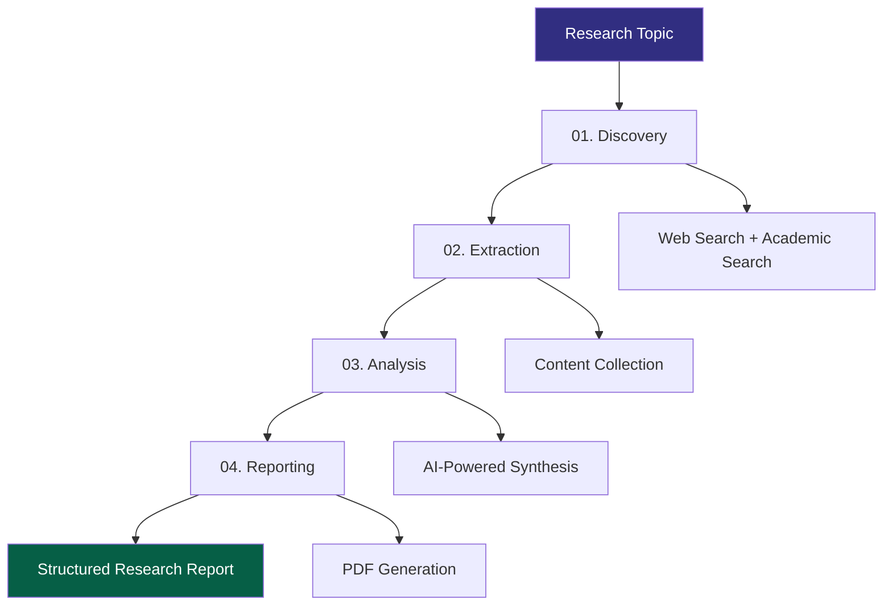
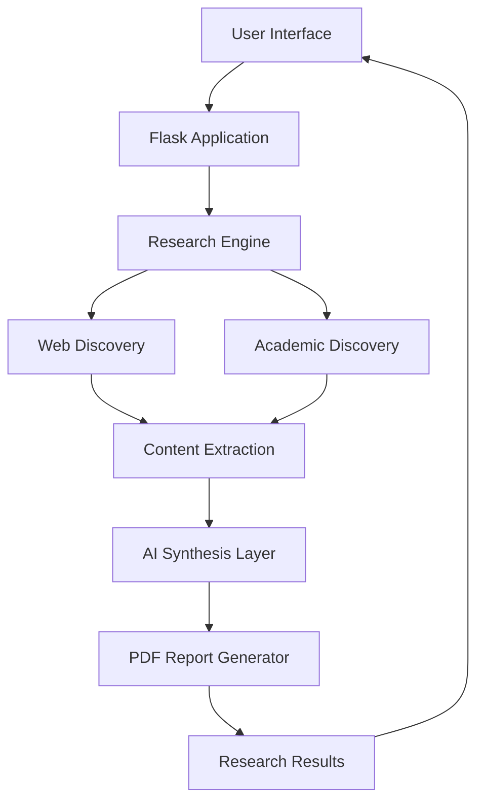

<div align="center">


<br/>


<br/><br/>

**An AI-powered research platform for automated information discovery, content extraction, analysis, and report generation.**

<br/>

[Live Application](https://ares-2.onrender.com/) · [Source Code](https://github.com/priyanshukumarverma091-hub/ARES)

<br/>


</div>

---

## Overview

ARES (Autonomous Research Engine System) is an AI-powered research platform designed to streamline the process of discovering, collecting, analyzing, and organizing information.

Traditional research requires navigating multiple websites, examining academic publications, extracting relevant information, and manually organizing findings.

ARES brings these activities into a unified workflow.

Users provide a research topic, and the system performs web and academic discovery, extracts relevant content, uses an AI model to synthesize findings, and generates a downloadable PDF report.

**Core philosophy: Don't just search. Discover.**

## Key Features

| Feature | Description |
|---|---|
| Web Discovery | Searches the web for relevant research material. |
| Academic Discovery | Integrates academic discovery through arXiv and Crossref. |
| Content Extraction | Extracts useful information from discovered web pages. |
| AI Research Synthesis | Uses an LLM to organize collected information into structured findings. |
| Research Analytics | Presents research statistics and discovered sources. |
| PDF Generation | Generates downloadable research reports. |
| Asynchronous Processing | Runs research tasks independently of the initial HTTP request. |

## Research Workflow

ARES follows a four-stage research pipeline.



### 01. Discovery

The system searches for relevant information using web search and academic research discovery sources.

### 02. Extraction

Relevant content is collected and extracted from discovered sources for further processing.

### 03. Analysis

The collected information is processed using an AI model to generate structured research findings.

### 04. Reporting

The final findings are organized into a research report and made available through the web interface and PDF download.

## System Architecture



## Technology Stack

| Layer | Technologies |
|---|---|
| Backend | Python, Flask |
| AI Integration | OpenRouter API |
| Language Model | NVIDIA Nemotron |
| Web Search | DDGS |
| Content Extraction | Trafilatura |
| Browser Automation | Playwright |
| Academic Sources | arXiv, Crossref |
| PDF Generation | ReportLab |
| Database | SQLite |
| Deployment | Render |

## Project Structure

```text
ARES/
│
├── app.py
├── main.py
├── requirements.txt
├── vercel.json
├── .env
│
├── reports/
├── logs/
│
└── README.md
```

## Getting Started

### Prerequisites

- Python 3.10 or later
- pip
- OpenRouter API key

### 1. Clone the Repository

```bash
git clone https://github.com/priyanshukumarverma091-hub/ARES.git

cd ARES
```

### 2. Create a Virtual Environment

```bash
python -m venv venv
```

Activate the environment:

**Windows**

```bash
venv\Scripts\activate
```

**Linux / macOS**

```bash
source venv/bin/activate
```

### 3. Install Dependencies

```bash
pip install -r requirements.txt
```

### 4. Install Playwright Browser

```bash
playwright install chromium
```

### 5. Configure Environment Variables

Create a `.env` file in the project root.

```env
OPENROUTER_API_KEY=your_openrouter_api_key
```

Keep API credentials private. Never commit `.env` to a public repository.

### 6. Start the Application

```bash
python app.py
```

Open:

```text
http://127.0.0.1:5000
```

## Deployment

ARES is deployed on Render.

**Live Application:** https://ares-2.onrender.com/

The application uses environment variables for API credentials. Configure the required variables in your deployment environment before starting the service.

## Design Goals

ARES is built around the following principles:

- Automated research workflows.
- Unified web and academic information discovery.
- AI-assisted synthesis of collected information.
- Structured and accessible research output.
- Practical application of language models and automation.

## Limitations

ARES is an AI-assisted research system, not a substitute for independent academic verification.

- AI-generated findings may contain inaccuracies.
- Source availability and extraction quality depend on external websites.
- Search results depend on external services.
- Important claims and references should be independently verified.
- Processing time varies with research complexity and external API response times.

## Future Development

Potential areas of development include:

- Multi-agent research orchestration.
- Source credibility and evidence scoring.
- Citation-aware synthesis.
- Research knowledge graphs.
- Academic paper comparison.
- Advanced research analytics.
- Additional export formats.

## Author

<div align="center">

**Priyanshu Kumar Verma**

AI/ML Researcher | Developer

[GitHub Profile](https://github.com/priyanshukumarverma091-hub)

<br/>

---

**ARES — Research Beyond Search.**


</div>
